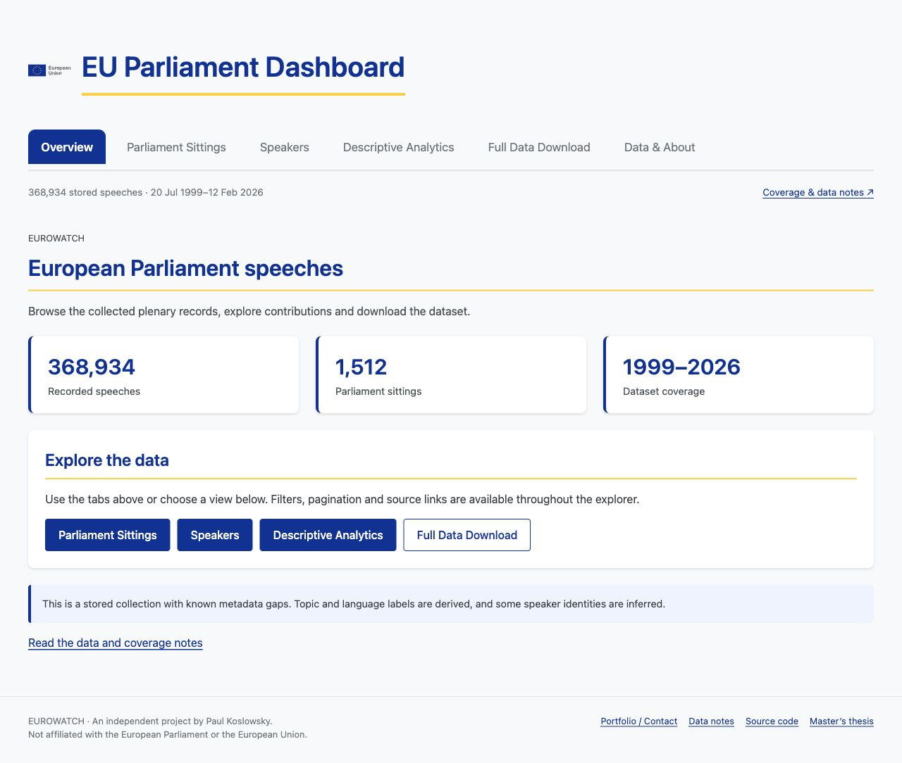
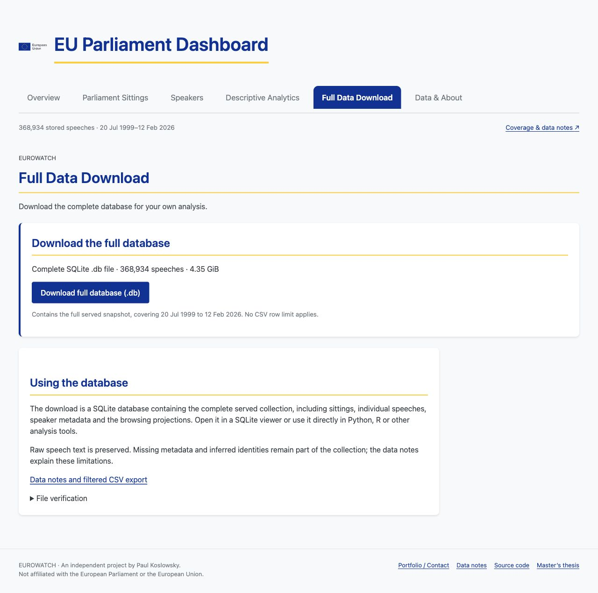

# Stabilization release candidate

Development branch: `codex/stabilize-eurowatch`. Implementation based on the [accepted plan](STABILIZATION_PLAN.md) and [initial audit](AUDIT_2026-11-05.md). This branch has no deployment workflow and does not change hosted production configuration.

## Result

The app is a read-only playground for the stored corpus, with three supported flows: sitting-to-contributions, speaker-to-contributions, and filtered topic-series exploration. It retains the original EU blue-and-gold visual identity, with a straightforward dashboard, explicit data notes, mobile layouts, URL state, readable contribution text, source links and bounded CSV exports. A separate Full Data Download tab provides the complete `.db` file by default, without the CSV row limit. Portfolio / Contact links point to Paul Koslowsky’s portfolio contact section.

The original 2,251-line HTTP server and browser workbench have been replaced by a small entry point and separate data/query/HTTP modules. The original implementation remains in Git history. Legacy ingestion tools remain separate; opening the public application cannot invoke them.

## Data safety

- Verified external backups of both original databases were created before implementation, including hashes, schema and table counts. Neither original database was migrated, pruned, relabeled or rebuilt.
- A new full snapshot was prepared from the verified backup: 368,934 speeches, 1,512 sittings, 20 July 1999–12 February 2026; zero sitting orphans.
- Main data, analytics and the manifest carry the same release ID. Promotion validates hashes and atomically selects a directory; restarting switches the pair together. Missing/mismatched analytics gives an explicit unavailable state while stored speech browsing remains available.
- The 29,399 unresolved references were found to be empty strings in the original `mep_id` column. Their speech text and raw labels remain available; they are not converted into fabricated numeric speaker records. Numeric unresolved IDs are supported separately by the browsing projection.
- Subsets prune dependent speeches and obsolete legacy sitting HTML on the copy, regenerate analytics, and compact the copy. The previous broken demo is not served.
- No large database, secret file, SSH key or generated fixture database belongs in Git.

## Verification

`npm run check` runs lint, formatting and 19 regression tests using disposable databases, local HTTP servers and the real process entry point. Coverage includes:

- Source preservation, backup integrity, immutable output, subset joins and rollback to a previous release.
- Complete/idempotent maintenance schema creation without upstream seeding.
- Blank and unresolved speaker references, literal name search, date boundaries and consistent pagination.
- Public maintenance/AI mutation denial, read-only SQLite connections, invalid fields/limits and security headers.
- Identical cold/warm filtered topic results, quarter aggregation, gaps, zero counts and CSV correspondence.
- Speech CSV quoting, selected-field validation and safe spreadsheet text.
- Missing snapshot startup failure, mismatched/unavailable analytics and graceful SIGTERM shutdown.

A clean `npm ci --omit=dev` was also run in a temporary checkout of the runtime files. It installed 128 packages, reported zero production vulnerabilities, and successfully served the full snapshot’s 1,512-sitting index. `npm audit --omit=dev --audit-level=high` passed. The offline CLD3 toolchain still has the separately documented development-only advisory; it is absent from the production install and never imported by the public server.

Manual browser checks against the full snapshot completed:

- Overview → sitting → expanded contribution → speaker profile; back/forward restored the selected view.
- Speaker-name filtering and differentiated API/inferred source labels.
- Single-topic selection, month-range changes and yearly grouping, with the matching seven-period table and download URL.
- Data notes, current-snapshot counts and bounded CSV selection.
- Full `.db` download enabled by default, with a dedicated tab, file size and SHA-256 verification. Fixture download bytes matched the reported hash; the full snapshot returned HTTP 200 and the expected 4,666,769,408-byte content length.
- Narrow layouts at 390px: overview/navigation, speaker search and topic controls had no page-wide horizontal overflow.
- Keyboard access to the skip link; native contribution disclosure controls and chart data-table disclosure.
- A hostile-text fixture containing `` rendered as text, with zero image elements inserted into the contribution content.
- No browser warnings/errors in the reviewed full-data preview.

These checks do not constitute a full accessibility conformance audit or a production-host load test.

## Local performance sample

Measured against the full prepared snapshot, with four concurrent requests and 12 requests per endpoint. Times include fetching/consuming the JSON response over localhost. The sample is a short smoke check, not a capacity forecast. Browser and API activity had already warmed some OS pages.

| Endpoint | Median | 95th percentile |
|---|---:|---:|
| Sittings, 25 rows | 4 ms | 55 ms |
| Speaker-name search | 5 ms | 8 ms |
| Speaker contributions, 20 rows | 38 ms | 153 ms |
| Sitting contributions, 20 rows | 3 ms | 7 ms |
| Topic series, yearly, three topics | 1 ms | 6 ms |
| Filtered export count | 1 ms | 2 ms |

The Node process used about 66 MiB resident memory after this sample. Hosting resources, reverse-proxy configuration, bandwidth and performance must still be verified before a future deployment.

## Deliberately deferred

Full-text multilingual search, identity reconciliation, dated membership reconstruction, new analysis, automated ingestion and a broader observatory remain later work. Existing missing/inferred metadata is explained instead of being silently rewritten. Legacy pipeline failure accounting, parsing accuracy and transaction handling require further work before unattended collection; those paths are not public runtime dependencies.

The new server requires a prepared release directory and a supported Node LTS runtime. Provision those before selecting this branch on any host. The original `main` application’s writable database configuration is not a drop-in configuration for this version. See [deployment and rollback notes](RENDER_DEMO.md).

## Reviewed interface

